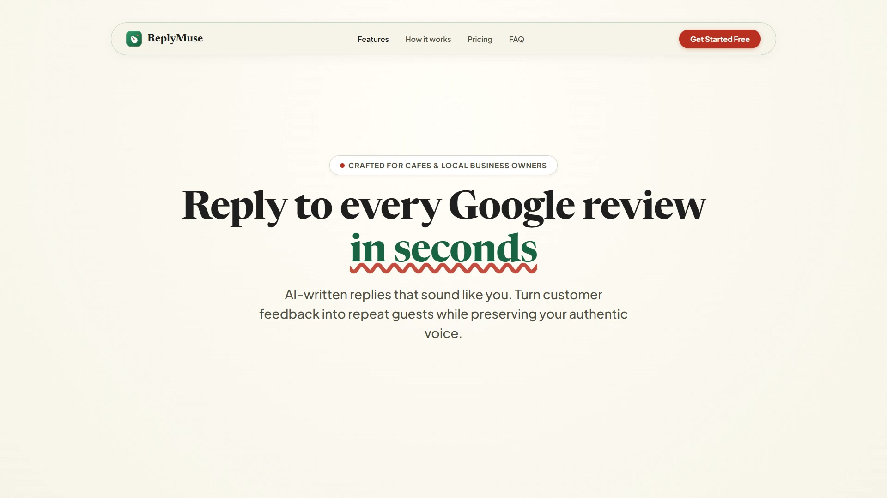
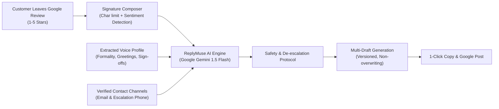

<div align="center">

  

  # ReplyMuse
  ### *Every reply, in your voice.*

  **A production-grade, privacy-first AI Review Reply studio crafted for cafes, restaurants, clinics, and indie businesses.**

  <p align="center">
    <a href="https://replymuse.vercel.app"><strong>🌐 Launch Live Application »</strong></a>
    <br />
    <a href="https://replymuse.onrender.com/api/docs">Interactive API Docs</a> •
    <a href="https://replymuse.onrender.com/api/health">System Health</a> •
    <a href="#-quickstart">Local Setup</a> •
    <a href="#-architecture--flow">Architecture</a> •
    <a href="#-security--production-readiness">Security</a>
  </p>

  <p align="center">
    <a href="https://replymuse.vercel.app"></a>
    <a href="https://replymuse.onrender.com/api/health"></a>
    <a href="https://neon.tech"></a>
    <a href="https://ai.google.dev/"></a>
  </p>

  <p align="center">
    
    
    
    
    
    
    
  </p>

</div>

---

## 📖 Table of Contents

- [The Problem vs. The Solution](#-the-problem-vs-the-solution)
- [Architecture & Flow](#-architecture--flow)
- [Core Features](#-core-features)
- [Live Environments](#-live-environments)
- [Technology Stack](#-technology-stack)
- [API Reference](#-api-reference)
- [Security & Reliability](#-security--reliability)
- [Quickstart Guide](#-quickstart)
- [Automated Testing](#-automated-testing)
- [Deployment Runbook](#-deployment-runbook)
- [License](#-license)

---

## 🎯 The Problem vs. The Solution

Customer reviews dictate the local search visibility and foot traffic of neighborhood businesses. Yet most owners either:
1. **Ignore reviews** due to lack of time, leaving negative feedback unaddressed and losing future guests.
2. **Paste generic ChatGPT prompts**, resulting in robotic, repetitive corporate clichés (*"We apologize for the inconvenience and strive for excellence..."*) that ruin authenticity.

| Dimension | Generic AI Replies | ReplyMuse Voice Engine |
| :--- | :--- | :--- |
| **Brand Tone** | Stiff, boilerplate, corporate apology template | **Extracted from 3–5 real past replies** (tone, cadence, vocabulary) |
| **Handling Praise** | Flat *"Thank you for your 5-star review!"* | **Highlights specific menu items & invites back warmly** |
| **Critical Feedback** | Defensive excuses or robotic admissions | **Empathetic de-escalation with verified direct phone/email** |
| **Safety Guardrails** | Susceptible to hallucinated refunds & prompt leaks | **Isolated untrusted review boundary with strict hallucination barriers** |
| **Turnaround** | 5–10 minutes of manual copy-pasting | **Instant 1-click tailored response ready to paste on Google** |

---

## 🏗 Architecture & Flow



---

## ✨ Core Features

### 1. Distinctive Editorial Studio Design
- Crafted in a calming warm cream aesthetic (`#F7F3E8`), rich forest green (`#1F7A5C`), and vibrant coral CTA pill buttons (`#EE6A4B`).
- Typography pairing: **Newsreader** editorial serif with **Plus Jakarta Sans** modern sans-serif.
- Frosted-glass sticky navigation, soft ambient depth, and zero tacky gradient cards.

### 2. Guided 3-Step Voice Profile Onboarding
- **Step 1: Business Profile**: Captures business category, neighborhood location, verified customer contact email, and escalation phone number.
- **Step 2: Voice Samples**: Ingests 3 to 5 authentic past responses written by the actual owner.
- **Step 3: Linguistic Profile Extraction**: Gemini analyzes samples to extract tone, formality level, customary greetings, personalized sign-offs, and custom rules for preferred or forbidden phrases.

### 3. Review Reply Composer
- Real-time character counter and input sanitizer (up to 2,000 characters).
- Interactive 1 to 5 star rating selector with sentiment detection.
- Multi-language generation support (English, Hindi, Hinglish).
- **Versioned Drafts**: Generate multiple alternatives without losing earlier revisions.
- In-place editor with instant clipboard copy and accessible toast feedback.

### 4. Safety & Non-Defensive De-escalation
- **Negative Feedback Handling**: Calms tensions by pairing genuine empathy with verified direct contact info for offline resolution.
- **Sensitive Allegation Detection**: Automatically flags reviews mentioning injury, food poisoning, discrimination, or legal threats for human inspection.
- **Prompt Injection Defense**: Review text is quarantined in XML fencing (`<untrusted_customer_review>`) so customer input can never override system instructions.

### 5. Freemium Quota Enforcement
- 10 free generations per calendar month strictly verified on the backend.
- Quota is deducted **only after successful AI delivery** — network blips or provider timeouts never deplete customer credits.
- Sliding-window rate limiting (10 requests/minute per authenticated user).

---

## 🌐 Live Environments

| Service | Environment | URL | Status |
| :--- | :--- | :--- | :--- |
| **Frontend Web App** | Production (Vercel) | [https://replymuse.vercel.app](https://replymuse.vercel.app) |  |
| **REST API Server** | Production (Render) | [https://replymuse.onrender.com](https://replymuse.onrender.com) |  |
| **Interactive API Docs** | Swagger UI | [https://replymuse.onrender.com/api/docs](https://replymuse.onrender.com/api/docs) |  |
| **Health Probe** | Monitoring Endpoint | [https://replymuse.onrender.com/api/health](https://replymuse.onrender.com/api/health) | `HTTP 200 OK` |
| **Database** | Neon Serverless | AWS us-east-2 (Pooled connection) | Active |

---

## 🛠 Technology Stack

```text
┌────────────────────────────────────────────────────────────────────────┐
│                              FRONTEND                                  │
│   React 18  •  TypeScript  •  Vite  •  Tailwind CSS  •  React Query    │
│   Google Identity Services (One Tap & GIS Button)  •  Lucide Icons    │
└───────────────────────────────────┬────────────────────────────────────┘
                                    │ HTTPS / REST (JSON)
┌───────────────────────────────────▼────────────────────────────────────┐
│                              BACKEND                                   │
│   FastAPI (Python 3.11+)  •  Pydantic v2  •  Uvicorn  •  Argon2id     │
│   SQLAlchemy 2.0 Async  •  asyncpg  •  Starlette CORS Middleware      │
└───────────────────┬───────────────────────────────┬────────────────────┘
                    │                               │
┌───────────────────▼──────────────┐ ┌──────────────▼────────────────────┐
│             DATABASE             │ │             AI ENGINE             │
│   Neon Serverless PostgreSQL     │ │   Google Gemini 1.5 Flash         │
│   Async Connection Pooler        │ │   Exponential Backoff & Retries   │
└──────────────────────────────────┘ └───────────────────────────────────┘
```

---

## 🔌 API Reference

Full interactive documentation is available live at [`/api/docs`](https://replymuse.onrender.com/api/docs).

### Authentication
- `POST /api/auth/register` — Create new account with email & password (Argon2id).
- `POST /api/auth/login` — Authenticate and receive JWT session bearer token.
- `POST /api/auth/google` — Authenticate with Google ID token credential (auto-provisions user & free tier).
- `POST /api/auth/logout` — Revoke session cookie.
- `GET  /api/auth/me` — Retrieve current authenticated user profile.

### Business & Voice Studio
- `GET  /api/business/profile` — Fetch business details & verified contact channels.
- `POST /api/business/profile` — Create or update business profile.
- `GET  /api/voice/profile` — Fetch extracted voice parameters.
- `POST /api/voice/analyze` — Extract linguistic profile from 3–5 sample replies.
- `GET  /api/voice/examples` — List uploaded sample replies.

### Review Reply Composer
- `POST /api/reviews` — Submit a customer review and generate the primary reply draft.
- `GET  /api/reviews/{id}` — Fetch review with all associated draft iterations.
- `POST /api/reviews/{id}/drafts` — Generate an alternative draft in brand voice.
- `PATCH /api/drafts/{id}` — Save user edits or mark draft as `copied` / `published`.
- `GET  /api/history` — Paginated review & reply history with search & star filters.
- `GET  /api/usage` — Check monthly allowance (generations remaining & reset date).

### System
- `GET  /api/health` — Service health probe and environment information.

---

## 🔒 Security & Reliability

- **Modern Password Hashing**: Passwords are cryptographically hashed using **Argon2id** (`time_cost=3`, `memory_cost=64MB`, `parallelism=4`).
- **Sliding-Window Rate Limiting**: Per-user sliding window limiter (10 requests/minute) protects against brute force and automated scraping.
- **Fail-Safe Quota System**: Server-enforced transactional tracking ensures customers never lose monthly quota if Gemini encounters a timeout or connection issue.
- **Zero Exposure of Client Secrets**: All external API keys and database credentials reside exclusively in server-side environment variables.
- **Strict Content Security**: Configured with `X-Frame-Options: DENY`, `X-Content-Type-Options: nosniff`, `Referrer-Policy: strict-origin-when-cross-origin`, and `Cross-Origin-Opener-Policy: same-origin-allow-popups`.

---

## 🚀 Quickstart

### Prerequisites
- **Python 3.11+**
- **Node.js 18+** and **npm**
- **Google Gemini API Key** ([Get free key](https://aistudio.google.com/app/apikey))

### 1. Clone the Repository
```bash
git clone https://github.com/Manindra-babu/ReplyMuse.git
cd ReplyMuse
```

### 2. Backend Setup
```bash
cd backend
python -m venv venv

# Windows:
.\venv\Scripts\activate
# macOS / Linux:
source venv/bin/activate

pip install -r requirements.txt
cp .env.example .env
```

Edit `backend/.env` with your Gemini key:
```ini
GEMINI_API_KEY=your_gemini_api_key_here
SECRET_KEY=generate_a_random_32_character_string
# Uses SQLite locally by default (zero setup required):
DATABASE_URL=sqlite+aiosqlite:///./replymuse.db
```

Start the backend:
```bash
uvicorn app.main:app --reload --port 8000
```
API docs available at: `http://localhost:8000/api/docs`

### 3. Frontend Setup
```bash
cd ../frontend
npm install
cp .env.example .env.local
```

Edit `frontend/.env.local`:
```ini
VITE_API_URL=http://localhost:8000/api
VITE_GOOGLE_CLIENT_ID=your_google_client_id.apps.googleusercontent.com
```

Start the frontend:
```bash
npm run dev
```
Open your browser at `http://localhost:5173`.

---

## 🧪 Automated Testing

### Backend Test Suite (Pytest)
```bash
cd backend
pytest -v
```
**18/18 Tests Passing**:
- `test_auth.py`: Account creation, password hashing, Google token verification, JWT issuance, expiration.
- `test_business.py`: Business details, multi-tenant isolation, cascade deletes.
- `test_voice.py`: Style extraction, custom voice guidance persistence.
- `test_reviews_drafts.py`: Positive reply generation, de-escalation for negative reviews, sensitive allegations, draft versioning.
- `test_quotas.py`: 10-reply quota enforcement, 429 rate limit responses, non-consumption on AI failure.
- `test_production_security.py`: Auth guards, sanitization, prompt injection defenses.

### Frontend Smoke Tests
```bash
cd frontend
npm test
```

---

## 🚢 Deployment Runbook

For complete hosting setup instructions on Render and Vercel, refer to [`DEPLOYMENT.md`](DEPLOYMENT.md).

### Summary:
1. **Database**: Spin up a free PostgreSQL database on [Neon](https://neon.tech).
2. **Backend (Render)**:
   - Create a Web Service connected to the GitHub repo.
   - Set environment variables: `DATABASE_URL`, `SECRET_KEY`, `GEMINI_API_KEY`, `GOOGLE_CLIENT_ID`, `ENVIRONMENT=production`.
3. **Frontend (Vercel)**:
   - Import repository with root directory set to `frontend`.
   - Set Config environment variables: `VITE_API_URL` and `VITE_GOOGLE_CLIENT_ID`.
4. **Google Cloud Console**:
   - Register your Vercel URL in **Authorized JavaScript origins**: `https://replymuse.vercel.app`.

---

## 📄 License

ReplyMuse is licensed under the [MIT License](LICENSE).

---

<div align="center">
  <sub>Crafted with passion for local business owners. Made with React, FastAPI, Neon, and Google Gemini.</sub>
</div>
